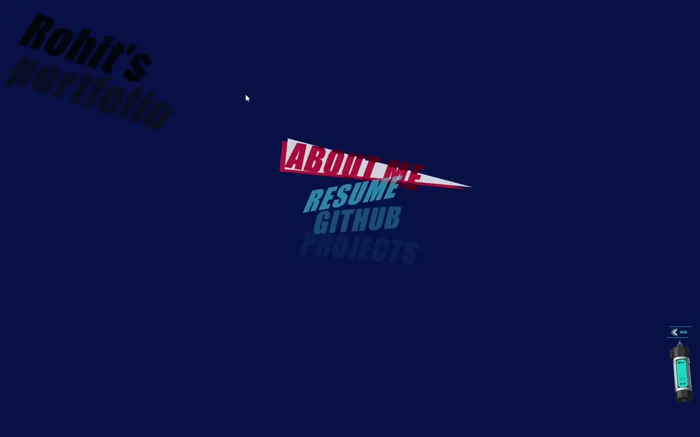
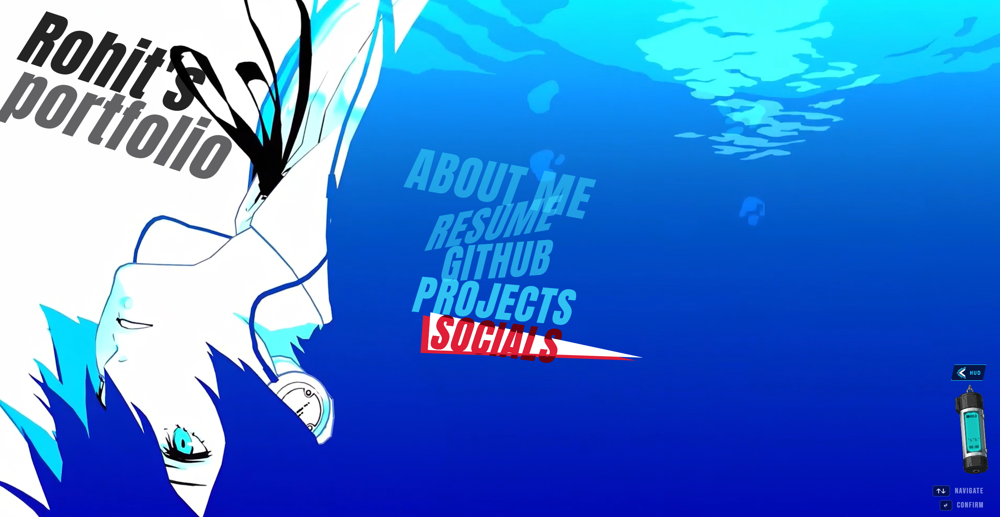
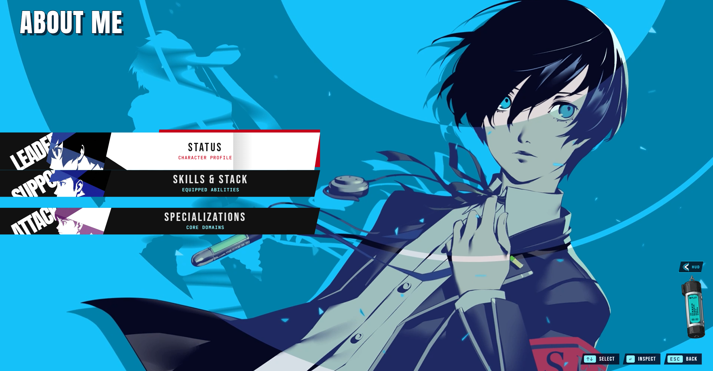
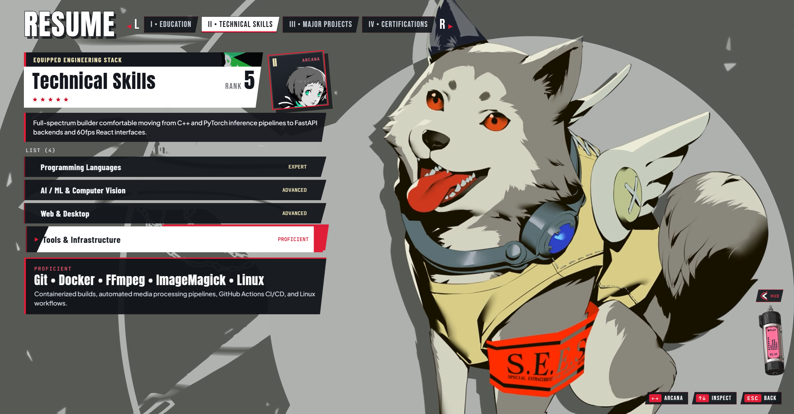
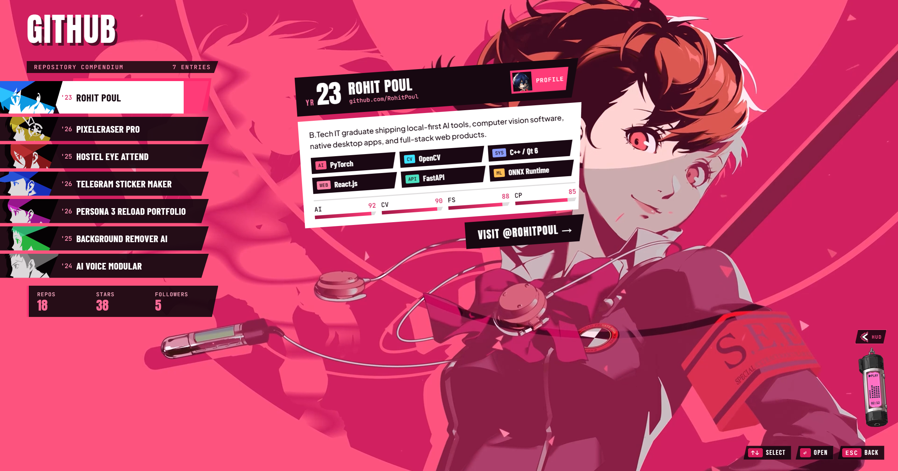
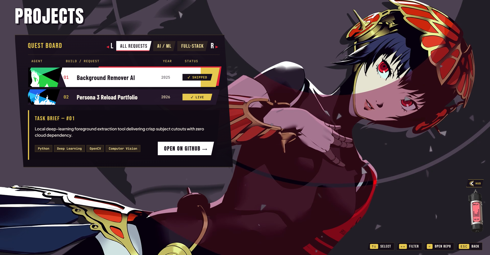
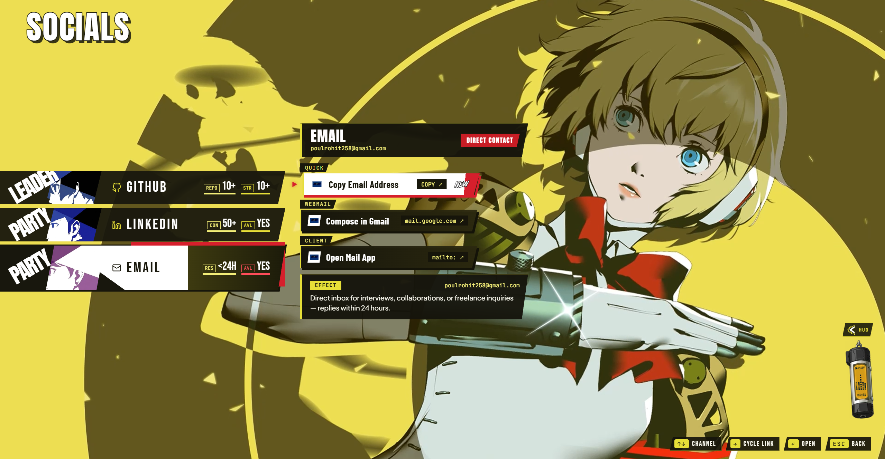

> [!NOTE]
> **Under Development** — Repository files are being cleaned up and updated gradually one by one, so not all source files here reflect the latest production build yet. Check out the live site below for the full latest version.

<div align="center">

# PERSONA 3 RELOAD PORTFOLIO

Interactive developer portfolio inspired by *Persona 3 Reload* — React 19, 1080p CMAF HLS chunked video streaming, and a route-reactive S.E.E.S. Walkman HUD.

<p>
  <a href="https://persona3.rohitpoul.workers.dev">
    
  </a>
</p>

<p>
  
  
  
  
</p>

</div>

---

## Preview



| Main Menu | About Me |
| :---: | :---: |
|  |  |

| Resume | GitHub |
| :---: | :---: |
|  |  |

| Projects | Socials |
| :---: | :---: |
|  |  |

---

## Highlights

- **5 Interactive Screens** — `About Me`, `Resume`, `GitHub` (live REST API stats), `Projects` (filterable Quest Board), and `Socials`.
- **1080p Chunked Streaming** — 2-second CMAF fMP4 HLS segments (`hls.js` Web Worker + native Safari HLS) with hover prefetching.
- **S.E.E.S. Walkman HUD** — Floating audio player with OLED equalizer, playlist drawer, and route-reactive themes.
- **Keyboard & Mouse** — `↑↓` select, `←→` switch tabs/filters, `Enter` inspect, `Esc` back.

---

## Run Locally

```bash
git clone https://github.com/RohitPoul/Person-3-Reload-Potfolio.git
cd Person-3-Reload-Potfolio
npm install
npm run dev
```

> Media assets (`public/streams/`, `src/assets/audio/`, `src/assets/images/`) are gitignored.

---

## Author

**Rohit Poul** — [Live Site](https://persona3.rohitpoul.workers.dev) · [GitHub](https://github.com/RohitPoul) · [LinkedIn](https://www.linkedin.com/in/rohit-poul-403a41289) · [Email](mailto:poulrohit258@gmail.com)

<sub>Inspired by <em>Persona 3 Reload</em> (Atlus). Licensed under MIT.</sub>
